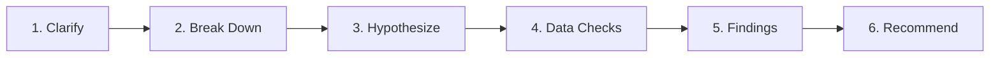
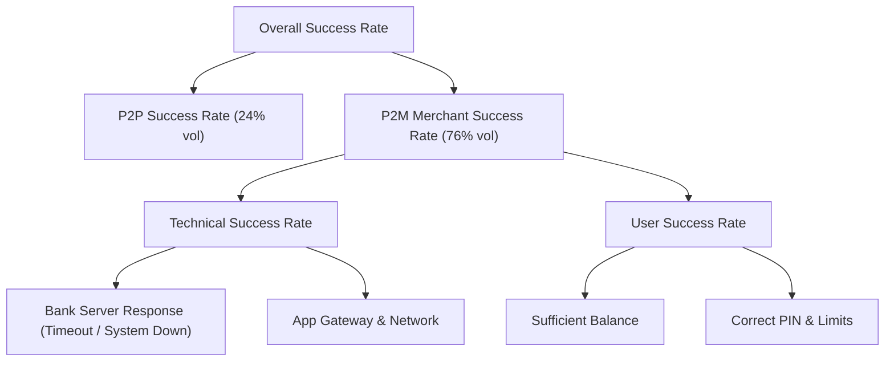

## Learning objectives

- Apply the structured 6-step CASE-6 framework to solve open-ended analytics problems under interview conditions.
- Ask targeted clarifying questions that define metric scopes and establish true baselines.
- Construct Mutually Exclusive and Collectively Exhaustive (MECE) metric trees using Mermaid diagrams.
- Formulate, prioritize, and test internal versus external hypotheses using database queries.
- Structure business recommendations that specify concrete owner actions, projected impact, and risk guardrails.

## Why this matters for a Data Analyst job

The case round is often the deciding factor in hiring decisions for freshers. While an Online Assessment checks whether you know SQL syntax, the case round reveals whether you think like a business analyst or simply a query writer. 

In real analytics teams, nobody hands you a clean SQL prompt like "Write a query to group orders by month". Instead, a Product Manager slacks you: *"Our UPI payment success rate dropped this week. Why?"* If you panic and write random queries, you waste days. If you follow a systematic framework—clarifying definitions, building a metric tree, and isolating outliers—you deliver clarity within hours.

<RealWorld>
At a digital payments company in Bengaluru processing 20,000 transactions daily, the Head of Operations notices that payment failures jumped from 2.2% to 3.4% in November. An inexperienced candidate might immediately claim 'users have insufficient balance'. A structured analyst clarifies the metric definition, excludes unresolved pending transactions, breaks down failures by partner bank, and discovers that Kaveri Co-op Bank has a 6.06% failure rate due to server timeouts during peak evening hours. That diagnosis leads directly to a bank-specific retry policy that saves ₹40 Lakh in monthly transaction volume.
</RealWorld>

## Concept

### The doctor analogy

Approach every business case like a physician:
1. **Listen to the symptoms:** Clarify the issue and ask about onset time.
2. **Review the vital signs:** Check high-level trends and overall metric baselines.
3. **Form a differential diagnosis:** List possible causes (internal releases vs external outages).
4. **Order targeted tests:** Query specific segments (by bank, app, hour, or device).
5. **Prescribe treatment:** Recommend operational fixes, measure impact, and schedule follow-ups.

### The CASE-6 framework

To solve any business case in 30 minutes, execute these six steps in order:

<FormulaCard title="The CASE-6 Framework">
1. **Clarify:** Define the exact metric formula, the time window, the baseline, and any recent product or tracking changes.
2. **Break Down (Metric Tree):** Split the core metric into smaller, independent levers (MECE).
3. **Hypothesize:** Formulate 3 to 4 distinct hypotheses split across internal factors (bugs, releases) and external factors (bank outages, holidays, competitor campaigns).
4. **Data Checks:** Identify the exact tables, columns, and segmentation cuts (time, bank, app, city) needed to prove or disprove each hypothesis.
5. **Findings:** State what the data shows with exact numbers, eliminating unviable hypotheses.
6. **Recommend:** Propose a concrete action, quantify expected metric recovery, identify operational risks, and state the next monitoring step.
</FormulaCard>

### Case types you will encounter

In fresher Data Analyst interviews, business cases generally fall into four categories:

1. **Metric Drop / Spike:** "Revenue dropped 15%", "Payment failures rose 40%", "Delivery cancellations increased 25%".
2. **Product Launch / A/B Test:** "We launched instant credit to 10% of users; should we roll it out to 100%?"
3. **KPI & Dashboard Design:** "Design the executive scorecard for our collections operations team."
4. **Market Sizing / Fermi Estimation:** "Estimate the daily number of UPI payments at tea stalls in Mumbai."

### Managing your 30-minute interview budget

- **00–05 min (Clarify):** Restate the prompt, ask 3 to 4 clarifying questions, confirm the business objective.
- **05–10 min (Structure):** Draw or describe the metric tree, state your top hypotheses aloud.
- **10–20 min (Analyze):** Guide the interviewer through data cuts, ask for data points or write SQL.
- **20–25 min (Recommend):** Present your 3-part recommendation (Action, Impact, Risk).
- **25–30 min (Discussion):** Answer interviewer follow-ups and discuss edge cases.

<Tip>
Think aloud throughout the case. Interviewers grade your thought process, not whether you guessed the answer on minute one. Use transition phrases like: *"To isolate whether this drop is broad-based or localized, I would like to cut the failure rate by partner bank and payment app."*
</Tip>

### Case interview evaluation rubric

Hiring managers grade case performance across five core dimensions (0 to 4 points each, total 20 points):

| Dimension | Weak (0–1 pts) | Competent (2–3 pts) | Excellent (4 pts) |
|---|---|---|---|
| **Structure** | Disorganized, jumps to conclusions without clarifying. | Follows a framework; covers most branches of the metric tree. | Perfectly MECE; adapts framework dynamically to case nuances. |
| **Business Sense** | Unrealistic suggestions; ignores commercial realities. | Understands key levers; identifies plausible operational bottlenecks. | Deep domain intuition; connects technical metrics to company revenue. |
| **Data Approach** | Vague queries; does not specify table cuts or filters. | Names right tables and columns; considers basic segmentation. | Accounts for duplicates, pending states, small sample sizes, and outliers. |
| **Numbers & Rigor** | Ignores scale; quotes percentages without denominators. | Accurately calculates basic rates and comparative differences. | Quantifies excess failures, benchmarks against baselines, sanity checks math. |
| **Communication** | Monologues without pause; defensive when challenged. | Answers clearly; summarizes findings in logical order. | Crisp executive communication; active listening; leads with recommendations. |

## Worked examples

### Example 1: Building a metric tree for UPI payment success rate

A payments product manager states: *"Our payment success rate dropped this week."*

We decompose overall UPI transaction success into its mathematical components:

To test whether the drop is driven by partner banking systems or user errors, we run an initial SQL query on the `fintech` database to inspect failure rates by partner bank:

<SqlPlayground
  dataset="fintech"
  query={`WITH clean AS (
  SELECT DISTINCT txn_id, bank, status
  FROM transactions
)
SELECT
  bank,
  COUNT(*) AS n_txns,
  ROUND(100.0 * SUM(CASE WHEN status = 'FAILED' THEN 1 ELSE 0 END) / COUNT(*), 2) AS fail_pct
FROM clean
GROUP BY bank
ORDER BY fail_pct DESC, bank ASC;`}
  title="UPI Failure Rate by Partner Bank"
/>

The output immediately highlights **Kaveri Co-op Bank** as an extreme outlier at **6.06%**, whereas all seven other banks cluster between 2.16% and 2.94%.

### Example 2: Second-level segmentation by client app

Next, we evaluate whether client-side payment apps contribute to gateway instability:

<SqlPlayground
  dataset="fintech"
  query={`WITH clean AS (
  SELECT DISTINCT txn_id, payment_app, status
  FROM transactions
)
SELECT
  payment_app,
  COUNT(*) AS n_txns,
  ROUND(100.0 * SUM(CASE WHEN status = 'FAILED' THEN 1 ELSE 0 END) / COUNT(*), 2) AS fail_pct
FROM clean
GROUP BY payment_app
ORDER BY fail_pct DESC, payment_app ASC;`}
  title="UPI Failure Rate by Client Payment App"
/>

The data shows **NammaPay** at **5.10%** failure rate, compared to 1.85%–2.25% for PayZippy, QuickPaisa, and SabPay. Combining both cuts reveals two localized operational issues: Kaveri Bank's core banking timeouts and NammaPay's gateway stability.

### Example 3: Fermi estimation — daily UPI QR payments in a tier-1 city

**Prompt:** *"Estimate the daily volume of UPI QR micro-payments at roadside tea and snack stalls in a city of 1.2 Crore residents."*

1. **Supply Side (Stalls):**
   - Population = `1.2 Crore (12,000,000)`.
   - Density: 1 tea/snack stall per 600 people = `20,000 stalls`.
   - UPI Acceptance: 85% display QR codes = `17,000 active QR merchants`.
2. **Throughput per Stall:**
   - 300 customers daily (180 during peak morning/evening hours, 120 off-peak).
   - Payment split: 70% UPI, 30% cash = `210 UPI payments/day/stall`.
3. **Total Daily Payments:**
   - `17,000 stalls * 210 payments = 3,570,000 (~35.7 Lakh payments/day)`.
4. **Demand-Side Sanity Check:**
   - Working adult population (ages 18–60) = 60% of 1.2 Cr = `72 Lakh adults`.
   - If 25% of working adults buy one tea or snack daily = `18 Lakh people`.
   - At an average of 2 purchases daily = `36 Lakh payments`.
   - Both estimations converge on approximately 35 to 36 Lakh daily payments.

## Common mistakes

<CommonMistake>
Jumping immediately to SQL or data exploration without asking clarifying questions about metric definitions and comparison baselines.
</CommonMistake>

<CommonMistake>
Listing 15 unranked hypotheses simultaneously instead of grouping them logically into internal factors (bugs, releases) versus external factors (partner outages, holidays).
</CommonMistake>

<CommonMistake>
Ignoring sample size in segment cuts. Celebrating that hour 04 has a '50% failure rate' without noticing it represents only 2 total transactions is a red flag in technical interviews.
</CommonMistake>

<CommonMistake>
Ending the case with a vague summary like 'we should look into Kaveri Bank' instead of a concrete recommendation specifying an operational action, expected metric recovery, and a monitoring guardrail.
</CommonMistake>

<CommonMistake>
Failing to deduplicate records in analytics databases containing exact duplicate rows (such as `transactions.txn_id`), distorting volume metrics.
</CommonMistake>

## Practice questions

<PracticeSet ids={[
  "interview-pr-case-001",
  "interview-pr-case-002",
  "interview-pr-case-003",
  "interview-pr-case-004",
  "interview-pr-case-005",
  "interview-pr-case-006",
  "interview-pr-case-007",
  "interview-pr-case-008"
]} />

## Mini quiz

<Quiz questions={[
  {
    q: "What is always the first action a candidate should take in a business case interview?",
    options: [
      "Open the database and immediately run GROUP BY queries",
      "Ask clarifying questions to define the metric formula, timeline, and scope",
      "Guess which manager caused the mistake",
      "Propose a machine learning recommendation"
    ],
    answer: 1,
    explanation: "Clarifying definitions, baselines, and scope ensures you solve the actual business problem rather than an assumed one."
  },
  {
    q: "In an e-commerce revenue metric tree, which of the following is a MECE decomposition of Gross Revenue?",
    options: [
      "Orders + Refunds",
      "Traffic * Conversion Rate * Average Order Value",
      "Website Visitors + Mobile App Users",
      "Product Views * Discount Percentage"
    ],
    answer: 1,
    explanation: "Revenue = Traffic * Conversion Rate * Average Order Value is a classic MECE formulation where multiplying the components equals total revenue."
  },
  {
    q: "Which of the following is classified as an external hypothesis for an e-commerce order drop?",
    options: [
      "A bug in the Android checkout button pushed in yesterday's release",
      "A national payment gateway network outage affecting all merchant checkouts",
      "An unexpected change in the warehouse packing SLA",
      "Accidental removal of product discounts by the marketing team"
    ],
    answer: 1,
    explanation: "A national payment gateway outage is an external event outside the direct control or codebase of the company."
  },
  {
    q: "When analyzing hourly failure rates, you find hour 03 has an 80% failure rate across 5 transactions, while hour 20 has a 12% failure rate across 800 transactions. Where should operational remediation focus?",
    options: [
      "Hour 03 because 80% is the highest percentage",
      "Hour 20 because 12% on 800 transactions represents 96 failed customers (major volume), whereas hour 03 represents only 4 failed customers",
      "Neither, because nighttime data should always be ignored",
      "Both equally"
    ],
    answer: 1,
    explanation: "Impact equals rate times volume. Hour 20 impacts 96 customers during peak traffic, making it the clear operational priority over small-sample noise in hour 03."
  },
  {
    q: "What three components must every strong case recommendation include?",
    options: [
      "Action, Projected Impact, and Risk/Guardrail",
      "Code, Resume, and Salary Expectation",
      "Apology, Refund, and Customer Escalation",
      "Table Name, Column Name, and SQL Query"
    ],
    answer: 0,
    explanation: "A complete executive recommendation specifies what action to take, what metric improvement to expect, and what operational risk to monitor."
  }
]} />

## Interview angle

<InterviewAlert>
Case rounds test your structured communication. The interviewer is evaluating whether they can place you in front of a Vice President or Product Lead without having to translate your technical findings.
</InterviewAlert>

<InterviewQ q="Walk me through how you would approach 'orders dropped 15% last week'.">
I would use the CASE-6 framework. First, I would clarify whether the 15% drop is week-over-week or year-over-year, and confirm that tracking and logging remained active. Second, I would decompose orders into `Active Users * Conversion Rate`. Third, I would segment conversion rate by platform (Android, iOS, Web), city, and payment method to isolate the decline. Fourth, I would check internal changes (app updates, checkout bugs) and external factors (festival dates, competitor sales). Finally, once the root cause is isolated, I would present recommendations with expected recovery numbers and monitor daily orders until stabilized.
</InterviewQ>

<InterviewQ q="How do you prioritize which hypothesis to investigate first?">
I prioritize hypotheses based on expected impact and ease of verification. I calculate expected impact as `Affected Volume * Magnitude of Anomaly`. For instance, if a partner bank processing 30% of our transactions shows elevated errors, investigating its gateway logs yields far more recoverable revenue than investigating a payment method used by only 2% of users. I verify quick internal releases first before requesting third-party partner logs.
</InterviewQ>

<InterviewQ q="How do you conclude a case study when time is running out?">
I conclude with a structured 60-second executive summary: headline finding, root cause, and three-part recommendation. For example: *'In summary, our failure rate increased by 1.2 percentage points, driven by Kaveri Co-op Bank server timeouts during peak evening hours. I recommend implementing an exponential backoff retry policy for timeout codes, alerting users in-app during peak hours, and engaging Kaveri Bank's technical team; this should restore our overall failure rate to under 2.5% within two weeks.'*
</InterviewQ>

## Key takeaways

- Never begin solving without asking clarifying questions regarding metric definitions, baselines, and scopes.
- Use MECE metric trees to partition ambiguous metrics into verifiable mathematical levers.
- Differentiate between rate percentage and absolute volume impact to avoid chasing small-sample noise.
- Always deduplicate database tables (such as `transactions.txn_id`) before running analytical aggregations.
- Frame your final conclusion as an actionable business recommendation with projected impact and risk guardrails.

## Further reading

<FurtherReading ids={["mode-sql", "kaggle-learn"]} />
